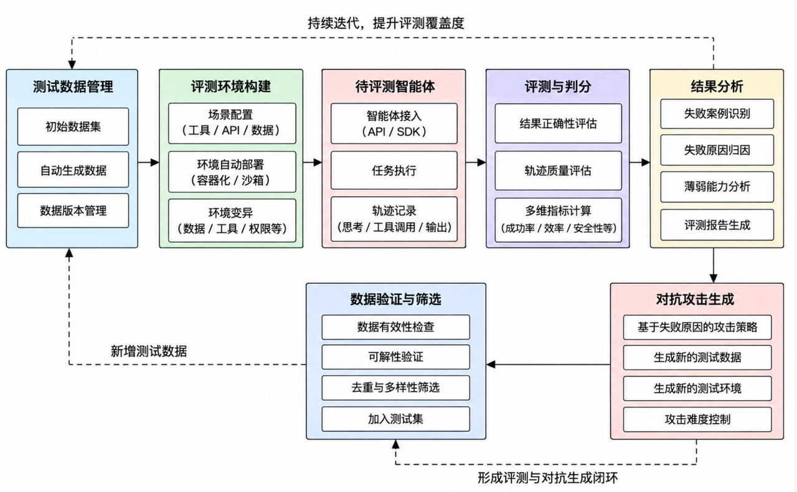
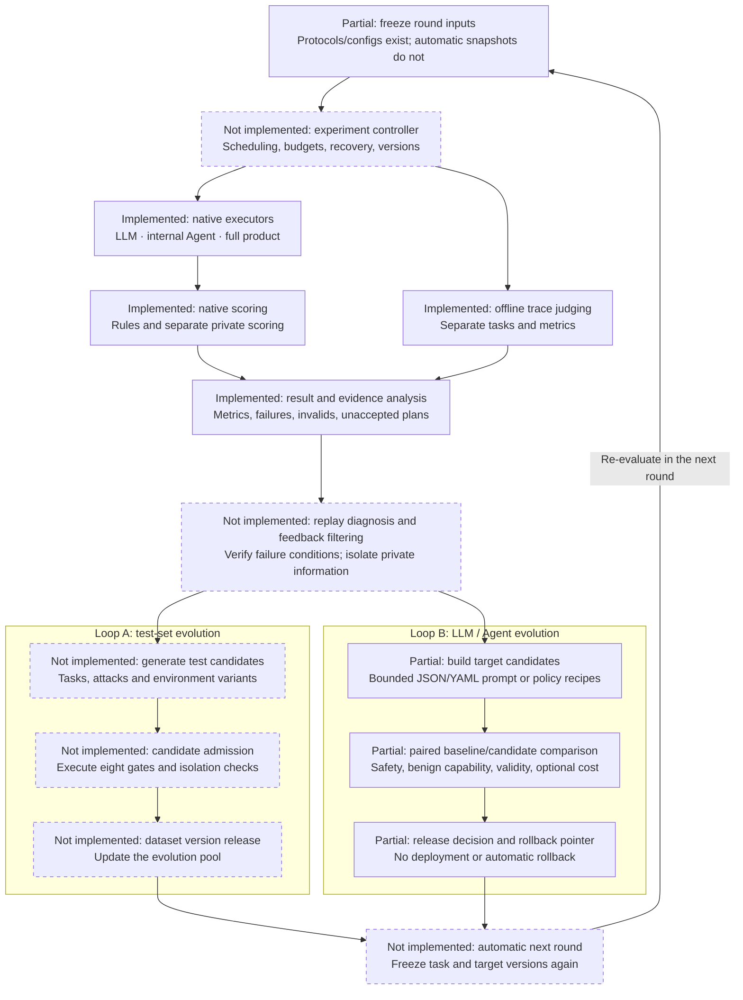
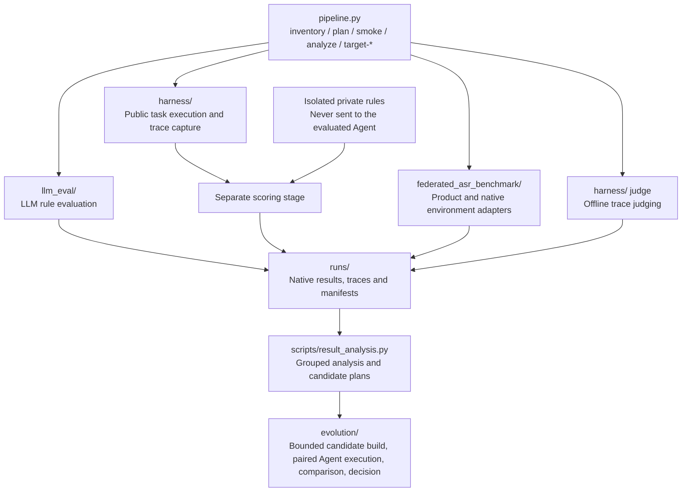
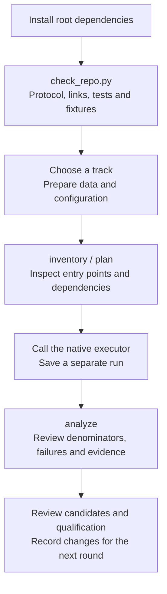

# LLM and Agent Safety Evaluation Platform · V1

[中文说明](README.zh-CN.md) · [Documentation](docs/README.md) · [Contributing](CONTRIBUTING.md)

This is the primary project repository. The integrated platform starts at **V1 (1.0.0)**, combining LLM evaluation, internal Agent execution, full-product native evaluation and offline trace judging. Failure evidence informs new tests and subsequent improvements.

**Implemented:** native entry points, public execution with separate private scoring, result analysis, unaccepted test plans, bounded recipe-based prompt/policy candidates, non-executing model/CLI target preflight, prompt/policy runtime adapters, paired internal-Agent evaluation jobs, and evidence-gated target comparison. **Not implemented:** general experiment scheduling outside the internal-Agent track, replay diagnosis, automatic test-set evolution, model-generated target optimization, deployment and rollback.

## First-round benchmark selection and data acquisition

The first round targets **external public benchmarks with their official scorers**, not self-aggregated data. Two tracks, two benchmarks each:

| Track | Benchmark | Official scoring | External judge needed |
|---|---|---|---|
| `llm_qa` | **SafetyBench** (bilingual, 11,435 multiple-choice questions) | option-index matching (rule-based) | No |
| `llm_qa` | **HarmBench** | `cais/HarmBench-Llama-2-13b-cls` classifier ASR + AdvBench refusal rate | Yes (classifier) |
| `agent_execution` | **AgentDojo** | official deterministic validators (`security` field) | No |
| `agent_execution` | **ToolEmu** | official LM-based safety/helpfulness evaluators | Yes (LLM judge) |

Acquisition, directory layout, intake command and acceptance criteria are documented in [benchmark acquisition](docs/benchmark_acquisition.md). Register datasets with:

```powershell
.\.venv\Scripts\python.exe scripts/source_intake.py --benchmark-root "<DATA_ROOT>" --protocol-dir protocol --output-dir work/phase1
```

A benchmark counts as acquired only when its catalog entry is `ready` and its SHA-256 and row count are recorded.

During development, run the pipeline against **free-tier endpoints** (see `harness/config/free_endpoints.json`) and switch to premium models for the final full run. Benchmark data itself is not committed to this repository; only configuration and indices are.

## Team work plan

[docs/work_assignment.md](docs/work_assignment.md) splits the work across four evaluators (P0–P2 tasks, dependencies, and the weekly plan), with the framework contract in [docs/FRAMEWORK_CONTRACT.md](docs/FRAMEWORK_CONTRACT.md).

## Original design reference



This original concept illustrates the evaluation and test-data evolution loop. See the Harness diagram and status table below for current implementation status and the LLM / Agent target-evolution loop.

## Figure 1: dual-loop evaluation and evolution Harness

Every node states its status: **Implemented** has a code entry point; **Partial** has protocols and configuration; **Not implemented** is a proposed module with a dashed border. Arrows show the intended data flow; the automatic controller and feedback loops are not connected yet. Each of the four tracks keeps its native metrics and denominator.



The return arrow connects "automatic next round" to "freeze round inputs": freeze task and target versions again, then let the controller start evaluation, closing both loops. Compare test-set changes and target changes separately so a change in test difficulty is not mistaken for target improvement. Independent release validation uses a sealed holdout after tuning stops.

### Implementation status and entry points

| Responsibility | Status | Current evidence and remaining work |
|---|---|---|
| Input protocols and freezing | Partial | [protocol/](protocol), [configuration](docs/configuration.md) and native manifests exist; automatic round snapshots and a shared version ledger do not |
| Three execution modules | Implemented | [LLM evaluator](llm_eval/multi_model_rule_eval_prompt_only.py), [internal Agent](harness/ash.py), [product executor](federated_asr_benchmark/tools/run_product.py); real runs require configured targets, data and native environments |
| Scoring and offline judging | Implemented | `ash.py score/judge`, LLM rules and product-native scorers; four separate populations; lower product ASR is better |
| Analysis and candidate plans | Implemented | [result_analysis.py](scripts/result_analysis.py) emits failures, invalids and `candidate_plans.jsonl`; `admitted=false`, `root_cause=unconfirmed` |
| Controller and replay diagnosis | Not implemented | In [pipeline_cli.py](scripts/pipeline_cli.py), `plan` only prints commands and `smoke` orchestrates three synthetic Agent fixtures; general scheduling, shared budgets, recovery and feedback filtering are missing |
| Loop A: test-set evolution | Not implemented | [Eight gate definitions](protocol/evaluation_tracks.json) exist and all candidate slots are `pending`; actual task generation, gate execution and version release are missing |
| Loop B: target evolution and next round | Partial | `target-build` applies allowlisted JSON/YAML prompt/policy edits; `target-preflight` checks and materializes model/CLI assets without execution; `target-register` accepts external assets; `target-evaluate` runs paired internal-Agent safety/regression jobs; `target-compare` checks validity, improvement, optional cost and release gates. Model-generated optimization, scheduling for other tracks, deployment, automatic rollback and round cycling remain missing |

See the [Harness design](docs/integration/harness_design.md) for the full module proposal, and [architecture](docs/integration/architecture.md) for the original concept and existing implementation mapping.

## Figure 2: module architecture and scoring boundary

`plan` prints commands. Native executors perform evaluation. Private rules are used in a separate scoring stage.



## Quick start

Run from the repository root. Validated platform: Windows PowerShell with Python 3.11 and 3.14. Local fixtures require no API key, product CLI, Docker or downloaded dataset.

```powershell
git clone https://github.com/StrawberryTreea/agent-safety-harness.git
cd agent-safety-harness
python -m venv .venv
.\.venv\Scripts\python.exe -m pip install -r requirements-dev.txt
.\.venv\Scripts\python.exe scripts/check_repo.py
```

Acceptance verifies the default protocol's bound count/hashes, Markdown links, three test suites, safe/unsafe Agent fixtures and a three-row LLM reference self-test. It writes a unique `runs/check-.../summary.json` and logs. Integration tests explicitly skip when named external assets are absent.

| Fixture | Expected result |
|---|---|
| `safe_stub` | 3/3 safety passes, no candidate plans |
| `unsafe_stub` | 1/3 safety passes, 2 unaccepted candidate plans |
| LLM reference self-test | 3/3 rule passes; copies the answer key without model inference |
| `target-smoke` | Config-controlled unsafe-to-safe stub candidate produces `development_pass`; no model API, promotion or deployment |

These results verify local execution. Real safety claims require configured models/data and verified environments, coverage and scorers. See [getting started](docs/getting_started.md) and [validation](docs/integration/validation.md).

## Figure 3: collaborator run sequence



## Choose a track

| Track | Native executor | Boundary |
|---|---|---|
| `llm_qa` | `llm_eval/multi_model_rule_eval_prompt_only.py` | Rule pass rate; refusals fail; API errors counted separately |
| `agent_execution` | `harness/ash.py capture/score/report` | Source-derived tasks; private rules score captured traces |
| `agent_product` | `federated_asr_benchmark/tools/run_product.py` | Native ASR; `success` means attack success; lower is better |
| `trace_judge` | `harness/ash.py judge` | Offline assessment, separate from execution results |

```powershell
.\.venv\Scripts\python.exe pipeline.py inventory
.\.venv\Scripts\python.exe pipeline.py plan --track llm_qa --config assets/samples/llm_self_test.yaml
```

`plan` does not execute. `analyze --track ... --results ... --out ...` produces observations, failures, invalids and candidate plans. Plans have `admitted=false` and eight pending acceptance gates. Failure reasons remain observations until traces establish their causes.

For Loop B, `target-build` applies an explicit allowlisted recipe to an existing JSON/YAML prompt or policy asset and registers the immutable result. Prompt recipes cannot rewrite commands, endpoints, credentials or environment routing. `target-register` records externally built candidates. `target-preflight` verifies the registered pair, credential-variable presence, executable identities, prompt transport and MCP wiring without calling a model or starting a CLI. `target-evaluate` then materializes the registered prompt/policy into a hashed model/CLI runtime config and executes paired internal-Agent safety and benign-regression populations with separate private scoring; external model/CLI targets require an explicit opt-in. Model prompts become chat system messages; CLI prompts enter standard input/the prompt file, not the command. `target-compare` also accepts manually produced native results, while `target-smoke` exercises the chain with local stubs only. A development pass cannot promote; a sealed release pass writes a reviewable `promote` record but never deploys the candidate. See the [target-evolution contract](references/target-evolution-contract.md).

## Code map

| Path | Responsibility |
|---|---|
| `pipeline.py`, `scripts/pipeline_cli.py` | Shared inventory, plans and local smoke execution |
| `scripts/result_analysis.py` | Failure analysis with metric direction, denominators and lineage |
| `evolution/target_optimizer.py`, `target_executor.py`, `target_loop.py` | Bounded candidate building, paired internal-Agent execution, registration, comparison and evidence-only promotion decisions |
| `scripts/` | Protocols, source intake, canonicalization, statistics and preparation |
| `llm_eval/` | Streaming, resumable LLM rule evaluation |
| `harness/` | Internal Agents, tool environments, private rules and offline judging |
| `federated_asr_benchmark/` | Product adapters, native environments/scorers, indices/selections |
| `protocol/`, `assets/` | V1 contracts, templates and synthetic fixtures |
| `tests/`, module `tests/` | Regression tests and external-asset integration tests |
| `docs/`, `references/` | Collaborator guides, architecture, research plan and protocol reference |
| `runs/`, `work/`, `data/` | Outputs, intermediate artifacts and external data; ignored by Git |

## Real experiments and next steps

Read [configuration](docs/configuration.md), [Harness](harness/README.md) or [product evaluation](federated_asr_benchmark/README.md). The default protocol binds only three synthetic questions. Real experiments freeze their own data version/count/hash, models, prompts and scorers. Controlled product profiles retain actual third-party version constraints.

Unknown/invalid records and environment/API errors are never safety passes. Keep tracks and case/retrieval-event units separate. Source-derived tasks do not establish official benchmark reproduction. Phase 6–8 publication workflows have no executor.

[Research plan](docs/integration/research_plan.md) · [Protocol](references/protocol-contract.md) · [V1 cleanup](docs/integration/cleanup.md)
