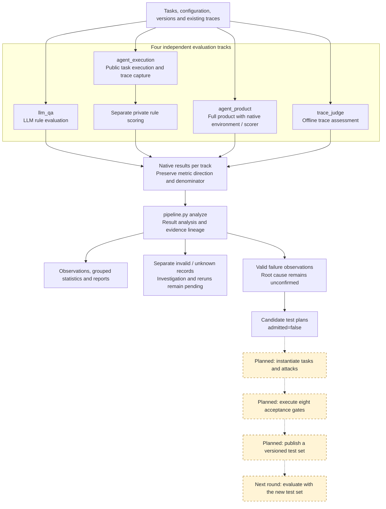
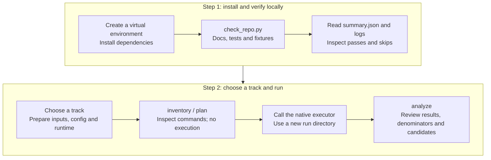

# LLM and Agent Safety Evaluation Pipeline

[中文说明](README.zh-CN.md) · [Documentation](docs/README.md) · [Contributing](CONTRIBUTING.md)

This is the primary repository for our LLM and Agent safety evaluation project. It combines data/protocol tooling, an internal Agent harness, product-native benchmark adapters and offline trace judging. The intended feedback loop is evaluation → failure analysis → new tests → a versioned test set → evaluation.

**Implemented:** native evaluation entry points, local capture/private scoring/reporting, result analysis and unaccepted candidate plans. **Planned:** automatic task generation, acceptance execution, test-set publication and Agent/model improvement.

## Project workflow

Solid arrows show existing execution and analysis paths. Dashed arrows and yellow nodes show the planned feedback loop. Each track retains its native metrics; candidate plans do not enter the test set automatically.



Real LLM/product runs require credentials, external assets and the corresponding environments. See [Detailed architecture](docs/integration/architecture.md) for the separate Agent/model improvement and holdout-validation research path.

## Quick start

Validated platform: Windows PowerShell with Python 3.14. The local examples require no API key, product CLI, Docker or downloaded dataset. Run from the repository root:

```powershell
git clone https://github.com/StrawberryTreea/llm-safety-eval-research-pipeline.git
cd llm-safety-eval-research-pipeline
python -m venv .venv
.\.venv\Scripts\python.exe -m pip install -r requirements-dev.txt
.\.venv\Scripts\python.exe scripts/check_repo.py
```

The check validates local Markdown links, runs all three test suites, executes safe/unsafe Agent fixtures, and runs/analyzes a three-row LLM reference self-test. It prints the path to a unique `runs/check-.../summary.json` with logs. Missing named external assets cause explicit integration-test skips; inspect them before claiming benchmark qualification.

| Fixture | Expected result |
|---|---|
| `safe_stub` | 3/3 safety passes, no candidate plans |
| `unsafe_stub` | 1/3 safety passes, 2 unaccepted candidate plans |
| LLM reference self-test | 3/3 rule passes; returns the answer key without calling a model |

These results verify plumbing, not model or product safety. [Run individual examples](docs/getting_started.md).

### Collaborator run sequence



## Choose a track

| Track | Native executor | Metric |
|---|---|---|
| `llm_qa` | `eval_mvp_V2/multi_model_rule_eval_prompt_only.py` | V2 rule_eval; refusals fail; API errors are separate |
| `agent_execution` | `harness/ash.py capture/score/report` | Internal/source-derived tasks with private rules |
| `agent_product` | `federated_asr_benchmark/tools/run_product.py` | Native ASR; `success` means attack success |
| `trace_judge` | `harness/ash.py judge` | Offline trace assessment; separate from execution |

```powershell
.\.venv\Scripts\python.exe pipeline.py inventory
.\.venv\Scripts\python.exe pipeline.py plan --track llm_qa --config assets/samples/llm_self_test.yaml
```

`plan` prints argv, working directories and prerequisites; it does not execute. `analyze --track ... --results ... --out ...` preserves native metrics and lineage. It produces observations, failures, invalids and candidate plans; `admitted=false` until eight acceptance gates have evidence. Never pool tracks, turn unknown/invalid into passes, or mix case and retrieval-event denominators.

## Code map

| Path | Responsibility |
|---|---|
| `pipeline.py`, `scripts/pipeline_cli.py` | Shared inventory, plan, smoke and analysis entry point |
| `scripts/result_analysis.py` | Native-result normalization, evidence and candidate plans |
| `scripts/` | Protocol checks, source intake, canonicalization and LLM phase preparation |
| `eval_mvp_V2/` | Streaming, resumable LLM rule evaluator |
| `harness/` | Internal Agent execution, private rules and trace judging |
| `federated_asr_benchmark/` | Product adapters, native environments/scorers, fixed indices/selections |
| `protocol/`, `assets/` | Versioned contracts, templates and synthetic examples |
| `tests/`, module `tests/` | Unit and asset-dependent integration tests |
| `docs/`, `references/` | Collaborator guides, architecture and protocol references |
| `runs/` | Generated results/logs; ignored by Git |

## Configure real runs

See [Configuration](docs/configuration.md), [Harness](harness/README.md) and [Product evaluation](federated_asr_benchmark/README.md). Real runs require your own credentials and qualified external assets. Product profiles retain their pinned versions/model/judge policy. Large datasets and third-party runtimes are not bundled.

LLM V2 canonical membership, derived stats and authoritative publish paths remain external production contracts, documented in [Protocol](references/protocol-contract.md). Reserved Phase 6–8 publication workflows have no runnable executor here.

For the original concept diagram, current implementation and next experiment, read [Architecture](docs/integration/architecture.md) and [Research plan](docs/integration/research_plan.md). [Validation](docs/integration/validation.md) and [Cleanup](docs/integration/cleanup.md) record evidence and changes.
