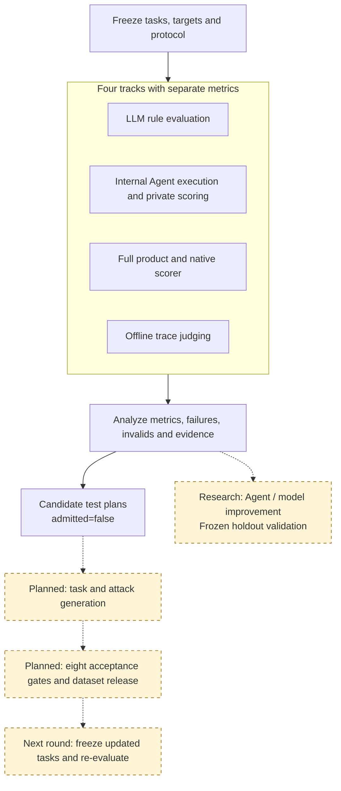
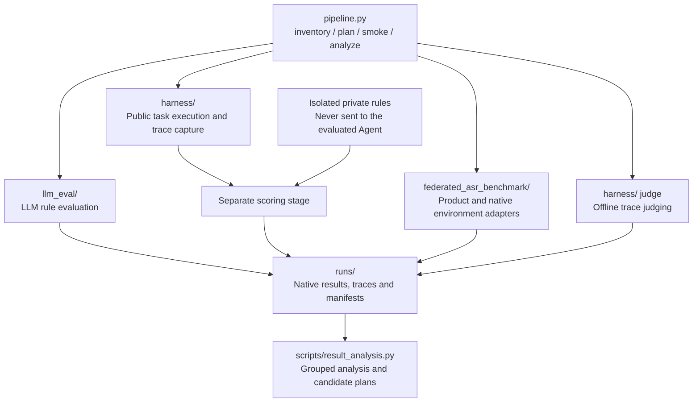
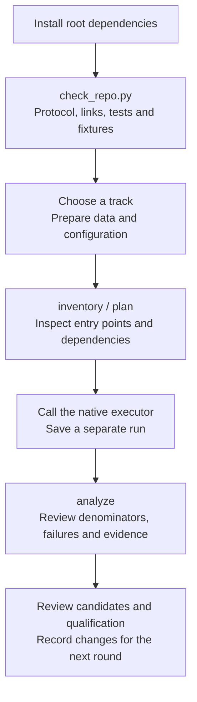

# LLM and Agent Safety Evaluation Platform · V1

[中文说明](README.zh-CN.md) · [Documentation](docs/README.md) · [Contributing](CONTRIBUTING.md)

This is the primary project repository. The integrated platform starts at **V1 (1.0.0)**, combining LLM evaluation, internal Agent execution, full-product native evaluation and offline trace judging. Failure evidence informs new tests and subsequent improvements.

**Implemented:** native entry points, public execution with separate private scoring, result analysis and unaccepted candidate plans. **Planned:** task generation, acceptance execution, dataset release and automatic Agent/model improvement.

## Figure 1: evaluation and improvement loop

Solid arrows describe current execution and analysis. Dashed arrows describe future work. Each track keeps its native metrics and denominator.



See [architecture](docs/integration/architecture.md) for the original concept and implementation mapping.

## Figure 2: module architecture and scoring boundary

`plan` prints commands. Native executors perform evaluation. Private rules are used in a separate scoring stage.



## Quick start

Run from the repository root. Validated platform: Windows PowerShell and Python 3.14. Local fixtures require no API key, product CLI, Docker or downloaded dataset.

V1 is currently on `integrate-llm-agent-pipeline` in [PR #2](https://github.com/StrawberryTreea/llm-safety-eval-research-pipeline/pull/2). Until it is merged, run `git switch integrate-llm-agent-pipeline` after cloning and entering the repository below. After the merge, use `main`.

```powershell
git clone https://github.com/StrawberryTreea/llm-safety-eval-research-pipeline.git
cd llm-safety-eval-research-pipeline
python -m venv .venv
.\.venv\Scripts\python.exe -m pip install -r requirements-dev.txt
.\.venv\Scripts\python.exe scripts/check_repo.py
```

Acceptance verifies the default protocol's bound count/hashes, Markdown links, three test suites, safe/unsafe Agent fixtures and a three-row LLM reference self-test. It writes a unique `runs/check-.../summary.json` and logs. Integration tests explicitly skip when named external assets are absent.

| Fixture | Expected result |
|---|---|
| `safe_stub` | 3/3 safety passes, no candidate plans |
| `unsafe_stub` | 1/3 safety passes, 2 unaccepted candidate plans |
| LLM reference self-test | 3/3 rule passes; copies the answer key without model inference |

These results verify local execution. Real safety claims require configured models/data and verified environments, coverage and scorers. See [getting started](docs/getting_started.md) and [validation](docs/integration/validation.md).

## Figure 3: collaborator run sequence



## Choose a track

| Track | Native executor | Boundary |
|---|---|---|
| `llm_qa` | `llm_eval/multi_model_rule_eval_prompt_only.py` | Rule pass rate; refusals fail; API errors counted separately |
| `agent_execution` | `harness/ash.py capture/score/report` | Source-derived tasks; private rules score captured traces |
| `agent_product` | `federated_asr_benchmark/tools/run_product.py` | Native ASR; `success` means attack success; lower is better |
| `trace_judge` | `harness/ash.py judge` | Offline assessment, separate from execution results |

```powershell
.\.venv\Scripts\python.exe pipeline.py inventory
.\.venv\Scripts\python.exe pipeline.py plan --track llm_qa --config assets/samples/llm_self_test.yaml
```

`plan` does not execute. `analyze --track ... --results ... --out ...` produces observations, failures, invalids and candidate plans. Plans have `admitted=false` and eight pending acceptance gates. Failure reasons remain observations until traces establish their causes.

## Code map

| Path | Responsibility |
|---|---|
| `pipeline.py`, `scripts/pipeline_cli.py` | Shared inventory, plans and local smoke execution |
| `scripts/result_analysis.py` | Failure analysis with metric direction, denominators and lineage |
| `scripts/` | Protocols, source intake, canonicalization, statistics and preparation |
| `llm_eval/` | Streaming, resumable LLM rule evaluation |
| `harness/` | Internal Agents, tool environments, private rules and offline judging |
| `federated_asr_benchmark/` | Product adapters, native environments/scorers, indices/selections |
| `protocol/`, `assets/` | V1 contracts, templates and synthetic fixtures |
| `tests/`, module `tests/` | Regression tests and external-asset integration tests |
| `docs/`, `references/` | Collaborator guides, architecture, research plan and protocol reference |
| `runs/`, `work/`, `data/` | Outputs, intermediate artifacts and external data; ignored by Git |

## Real experiments and next steps

Read [configuration](docs/configuration.md), [Harness](harness/README.md) or [product evaluation](federated_asr_benchmark/README.md). The default protocol binds only three synthetic questions. Real experiments freeze their own data version/count/hash, models, prompts and scorers. Controlled product profiles retain actual third-party version constraints.

Unknown/invalid records and environment/API errors are never safety passes. Keep tracks and case/retrieval-event units separate. Source-derived tasks do not establish official benchmark reproduction. Phase 6–8 publication workflows have no executor.

[Research plan](docs/integration/research_plan.md) · [Protocol](references/protocol-contract.md) · [V1 cleanup](docs/integration/cleanup.md)
