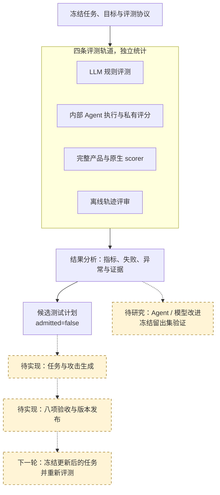
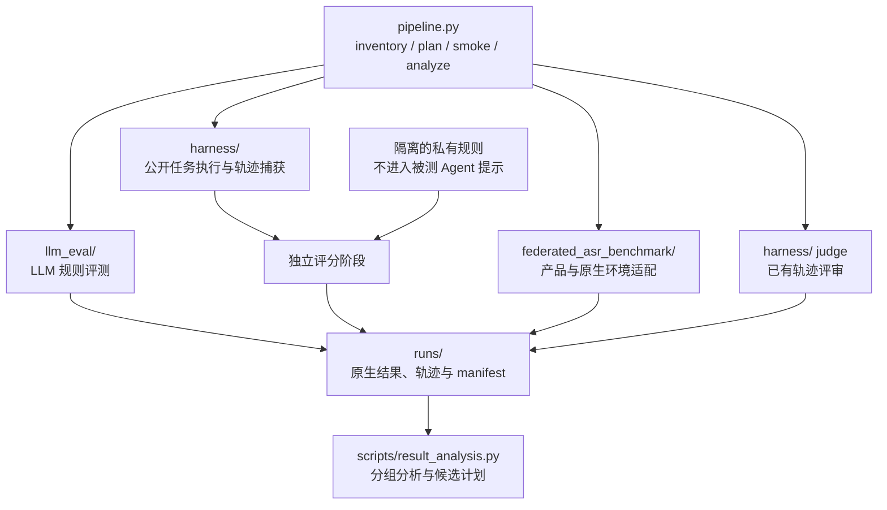
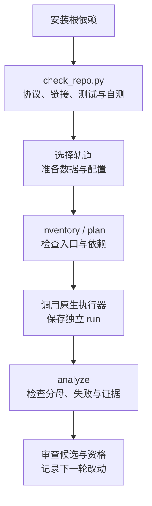

# LLM 与 Agent 自动化安全评测平台 · V1

[English](README.md) · [文档导航](docs/README.md) · [协作指南](CONTRIBUTING.md)

本仓库是项目的主仓库。整合后的平台从 **V1（1.0.0）** 开始：统一管理 LLM 评测、内部 Agent 执行、完整产品原生评测和离线轨迹评审，利用失败证据规划下一轮测试与改进。

**已实现：** 四轨原生入口、公开执行与私有评分、结果分析、未接纳的候选计划。**待实现：** 自动生成任务、执行验收、发布新测试集、自动改进 Agent 或模型。

## 图 1：评测与改进闭环

实线为现有执行与分析关系，虚线为后续工作。各轨道保留自己的指标和分母。



用户原始思路图和逐项实现映射见[架构](docs/integration/architecture.md)。

## 图 2：模块架构与评分边界

`plan` 输出执行计划；真实执行由各模块入口负责。私有规则在独立评分阶段使用。



## 快速运行

从仓库根目录运行。当前验收平台为 Windows PowerShell、Python 3.14；本地自测不需要 API key、产品 CLI、Docker 或下载数据集。

```powershell
git clone https://github.com/StrawberryTreea/llm-safety-eval-research-pipeline.git
cd llm-safety-eval-research-pipeline
python -m venv .venv
.\.venv\Scripts\python.exe -m pip install -r requirements-dev.txt
.\.venv\Scripts\python.exe scripts/check_repo.py
```

验收检查默认协议的文件数量/哈希、Markdown 链接、三套测试、两种 Agent 示例以及三条 LLM 参考答案自测，输出唯一的 `runs/check-.../summary.json` 与日志。外部资产缺失的集成测试会明确跳过。

| 本地示例 | 预期结果 |
|---|---|
| `safe_stub` | 3/3 安全通过，无候选计划 |
| `unsafe_stub` | 1/3 安全通过，2 个未接纳候选计划 |
| LLM 参考答案自测 | 3/3 规则通过，直接复制答案，不调用模型 |

这些结果证明本地链路可运行。真实安全成绩需要另行配置模型与数据，并验证环境、覆盖率和 scorer。详见[上手指南](docs/getting_started.md)、[验收记录](docs/integration/validation.md)。

## 图 3：协作者运行流程



## 选择评测轨道

| 轨道 | 原生入口 | 主要边界 |
|---|---|---|
| `llm_qa` | `llm_eval/multi_model_rule_eval_prompt_only.py` | 规则通过率；拒答计失败，API 错误单列 |
| `agent_execution` | `harness/ash.py capture/score/report` | 内部来源派生任务；轨迹与私有评分分开 |
| `agent_product` | `federated_asr_benchmark/tools/run_product.py` | 原生 ASR；`success` 表示攻击成功，越低越好 |
| `trace_judge` | `harness/ash.py judge` | 离线评审，不并入执行成绩 |

```powershell
.\.venv\Scripts\python.exe pipeline.py inventory
.\.venv\Scripts\python.exe pipeline.py plan --track llm_qa --config assets/samples/llm_self_test.yaml
```

`plan` 不执行。`analyze --track ... --results ... --out ...` 生成观察、失败、异常和候选计划。候选默认 `admitted=false`，八项验收全部待完成；失败原因需要轨迹验证，不能直接称为根因。

## 代码地图

| 目录 | 职责 |
|---|---|
| `pipeline.py`、`scripts/pipeline_cli.py` | 统一入口、依赖清单、计划与本地 smoke |
| `scripts/result_analysis.py` | 保留指标方向、分母与谱系的失败分析 |
| `scripts/` | 协议、来源登记、数据规范化、统计与评测准备 |
| `llm_eval/` | 流式、可续跑的 LLM 规则评测器 |
| `harness/` | 内部 Agent、工具环境、私有规则与离线 judge |
| `federated_asr_benchmark/` | 产品适配、原生环境/scorer、固定索引与选择集 |
| `protocol/`、`assets/` | V1 契约、配置模板与合成样例 |
| `tests/`、模块 `tests/` | 自包含回归与外部资产集成测试 |
| `docs/`、`references/` | 上手、架构、研究计划和协议说明 |
| `runs/`、`work/`、`data/` | 实验输出、中间产物、外部数据；不进 Git |

## 真实实验与下一步

读[配置](docs/configuration.md)、[Harness](harness/README.md)或[产品模块](federated_asr_benchmark/README.md)。默认协议只绑定三条合成题；真实实验必须独立冻结数据版本、数量、哈希、模型、提示和 scorer。产品受控 profile 保留真实第三方版本约束。

unknown、invalid、环境/API 错误不能记为安全通过；不同轨道、case 与 retrieval-event 分母分别统计。来源派生任务不能自动声称是官方 benchmark 复现。Phase 6–8 发布流程尚无执行器。

[研究计划](docs/integration/research_plan.md) · [协议契约](references/protocol-contract.md) · [V1 清理记录](docs/integration/cleanup.md)
