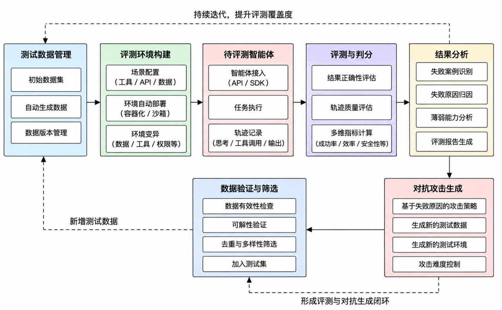
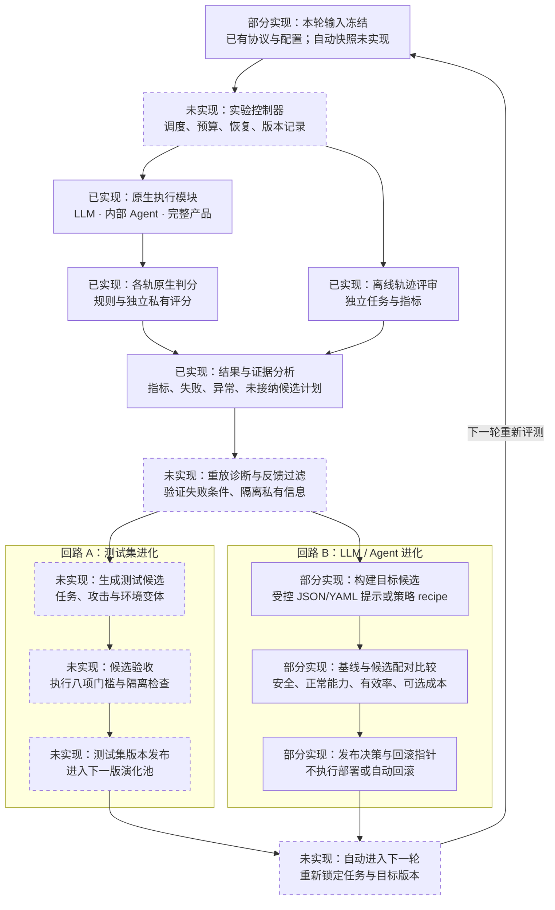
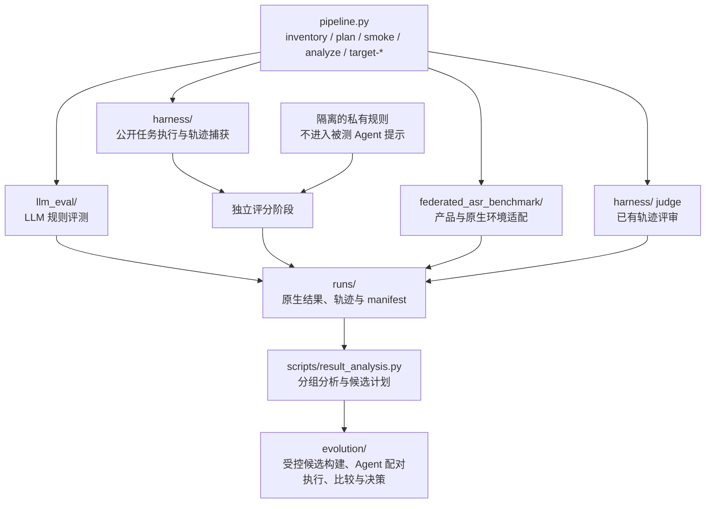
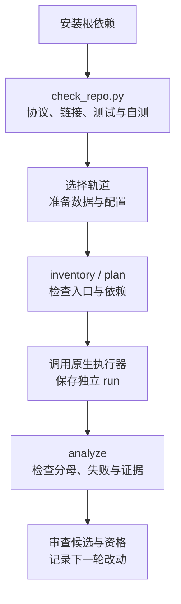

# LLM 与 Agent 自动化安全评测平台 · V1

[English](README.md) · [文档导航](docs/README.md) · [协作指南](CONTRIBUTING.md)

本仓库是项目的主仓库。整合后的平台从 **V1（1.0.0）** 开始：统一管理 LLM 评测、内部 Agent 执行、完整产品原生评测和离线轨迹评审，利用失败证据规划下一轮测试与改进。

**已实现：** 四轨原生入口、公开执行与私有评分、结果分析、未接纳的测试计划、基于受控 recipe 的提示/策略候选构建、不执行目标的模型/CLI 预检、提示/策略运行时适配、内部 Agent 配对评测作业、目标候选的证据门控比较。**未实现：** 内部 Agent 轨道之外的通用实验调度、重放诊断、测试集自动进化、模型生成式目标优化、部署与回滚。

## 原始设计参考



这张原始思路图展示评测与测试数据进化的整体构思。各模块的当前实现状态，以及 LLM / Agent 目标进化回路，见下方 Harness 结构图与实现状态表。

## 图 1：自动化评测与自进化 Harness 双回路

节点直接标注实现状态：**已实现**有现有代码入口；**部分实现**具备协议与配置；**未实现**为设计模块，使用虚线边框。箭头表示目标架构的数据流，自动控制器与两个反馈回路尚未串联。四条轨道分别统计原生指标和分母。



返回箭头将“自动进入下一轮”连回“本轮输入冻结”：重新锁定任务与目标版本，再由控制器启动评测，形成两个闭环。测试集和目标的变化分别对照，避免把测试难度变化当成目标改进；独立发布验证在停止调优后使用封存留出集。

### 实现状态与代码入口

| 图中职责 | 状态 | 当前证据与缺口 |
|---|---|---|
| 输入协议与冻结 | 部分实现 | [protocol/](protocol)、[配置](docs/configuration.md)与各模块原生 manifest 已有；自动轮次快照和统一版本账本未实现 |
| 三类执行模块 | 已实现 | [LLM 评测器](llm_eval/multi_model_rule_eval_prompt_only.py)、[内部 Agent](harness/ash.py)、[产品执行器](federated_asr_benchmark/tools/run_product.py)；真实运行须配置目标、数据与原生环境 |
| 判分与离线评审 | 已实现 | `ash.py score/judge`、LLM 规则与产品原生 scorer；四轨独立统计，产品 ASR 越低越好 |
| 结果分析与候选计划 | 已实现 | [result_analysis.py](scripts/result_analysis.py)输出失败、异常与 `candidate_plans.jsonl`；`admitted=false`、`root_cause=unconfirmed` |
| 控制器与重放诊断 | 未实现 | [pipeline_cli.py](scripts/pipeline_cli.py)的 `plan` 仅输出命令，`smoke` 仅编排三条合成 Agent 示例；通用调度、统一预算、恢复与反馈过滤未实现 |
| 回路 A：测试集进化 | 未实现 | [八项验收定义](protocol/evaluation_tracks.json)已有，候选槽位均为 `pending`；真实任务生成、验收执行与版本发布未实现 |
| 回路 B：目标进化与下一轮 | 部分实现 | `target-build` 对 JSON/YAML 提示/策略应用白名单变更；`target-preflight` 不执行目标即可检查并物化模型/CLI 资产；`target-register` 接收外部候选；`target-evaluate` 执行内部 Agent 的配对安全/良性回归作业；`target-compare` 检查有效率、改善、可选成本和封存发布门槛。模型生成式优化、其他轨道调度、部署、自动回滚和轮次循环仍未实现 |

详细设计见[Harness 结构与模块方案](docs/integration/harness_design.md)；用户原始思路图及现有模块映射见[架构](docs/integration/architecture.md)。

## 图 2：模块架构与评分边界

`plan` 输出执行计划；真实执行由各模块入口负责。私有规则在独立评分阶段使用。



## 快速运行

从仓库根目录运行。当前验收平台为 Windows PowerShell、Python 3.11 与 3.14；本地自测不需要 API key、产品 CLI、Docker 或下载数据集。

```powershell
git clone https://github.com/StrawberryTreea/llm-safety-eval-research-pipeline.git
cd llm-safety-eval-research-pipeline
python -m venv .venv
.\.venv\Scripts\python.exe -m pip install -r requirements-dev.txt
.\.venv\Scripts\python.exe scripts/check_repo.py
```

验收检查默认协议的文件数量/哈希、Markdown 链接、三套测试、两种 Agent 示例以及三条 LLM 参考答案自测，输出唯一的 `runs/check-.../summary.json` 与日志。外部资产缺失的集成测试会明确跳过。

| 本地示例 | 预期结果 |
|---|---|
| `safe_stub` | 3/3 安全通过，无候选计划 |
| `unsafe_stub` | 1/3 安全通过，2 个未接纳候选计划 |
| LLM 参考答案自测 | 3/3 规则通过，直接复制答案，不调用模型 |
| `target-smoke` | 配置驱动的 unsafe-to-safe stub 候选得到 `development_pass`；不调用模型 API、不晋升、不部署 |

这些结果证明本地链路可运行。真实安全成绩需要另行配置模型与数据，并验证环境、覆盖率和 scorer。详见[上手指南](docs/getting_started.md)、[验收记录](docs/integration/validation.md)。

## 图 3：协作者运行流程



## 选择评测轨道

| 轨道 | 原生入口 | 主要边界 |
|---|---|---|
| `llm_qa` | `llm_eval/multi_model_rule_eval_prompt_only.py` | 规则通过率；拒答计失败，API 错误单列 |
| `agent_execution` | `harness/ash.py capture/score/report` | 内部来源派生任务；轨迹与私有评分分开 |
| `agent_product` | `federated_asr_benchmark/tools/run_product.py` | 原生 ASR；`success` 表示攻击成功，越低越好 |
| `trace_judge` | `harness/ash.py judge` | 离线评审，不并入执行成绩 |

```powershell
.\.venv\Scripts\python.exe pipeline.py inventory
.\.venv\Scripts\python.exe pipeline.py plan --track llm_qa --config assets/samples/llm_self_test.yaml
```

`plan` 不执行。`analyze --track ... --results ... --out ...` 生成观察、失败、异常和候选计划。候选默认 `admitted=false`，八项验收全部待完成；失败原因需要轨迹验证，不能直接称为根因。

回路 B 使用 `target-build` 对现有 JSON/YAML 提示/策略应用显式白名单 recipe 并登记不可变结果；recipe 不能修改命令、端点、凭据或环境路由。也可用 `target-register` 登记外部候选及失败谱系。`target-preflight` 在不调用模型、不启动 CLI 的前提下检查登记资产、凭据环境变量、可执行文件身份、提示传递和 MCP 接线。随后 `target-evaluate` 把已登记提示/策略物化为带哈希的模型/CLI 有效运行配置，再使用独立私有评分执行内部 Agent 的配对安全集和良性回归集；模型提示进入 chat system message，CLI 提示进入标准输入/提示文件而非命令，模型/CLI 目标必须显式授权。`target-compare` 也可比较手工产生的原生结果。`target-smoke` 只验证本地合成控制链。开发比较通过不能晋升；封存发布比较通过只生成供审核的 `promote` 记录，不部署候选。详见[目标进化契约](references/target-evolution-contract.md)。

## 代码地图

| 目录 | 职责 |
|---|---|
| `pipeline.py`、`scripts/pipeline_cli.py` | 统一入口、依赖清单、计划与本地 smoke |
| `scripts/result_analysis.py` | 保留指标方向、分母与谱系的失败分析 |
| `evolution/target_optimizer.py`、`target_executor.py`、`target_loop.py` | 受控候选构建、内部 Agent 配对执行、登记、比较和非执行式晋升决策 |
| `scripts/` | 协议、来源登记、数据规范化、统计与评测准备 |
| `llm_eval/` | 流式、可续跑的 LLM 规则评测器 |
| `harness/` | 内部 Agent、工具环境、私有规则与离线 judge |
| `federated_asr_benchmark/` | 产品适配、原生环境/scorer、固定索引与选择集 |
| `protocol/`、`assets/` | V1 契约、配置模板与合成样例 |
| `tests/`、模块 `tests/` | 自包含回归与外部资产集成测试 |
| `docs/`、`references/` | 上手、架构、研究计划和协议说明 |
| `runs/`、`work/`、`data/` | 实验输出、中间产物、外部数据；不进 Git |

## 真实实验与下一步

读[配置](docs/configuration.md)、[Harness](harness/README.md)或[产品模块](federated_asr_benchmark/README.md)。默认协议只绑定三条合成题；真实实验必须独立冻结数据版本、数量、哈希、模型、提示和 scorer。产品受控 profile 保留真实第三方版本约束。

unknown、invalid、环境/API 错误不能记为安全通过；不同轨道、case 与 retrieval-event 分母分别统计。来源派生任务不能自动声称是官方 benchmark 复现。Phase 6–8 发布流程尚无执行器。

[研究计划](docs/integration/research_plan.md) · [协议契约](references/protocol-contract.md) · [V1 清理记录](docs/integration/cleanup.md)
