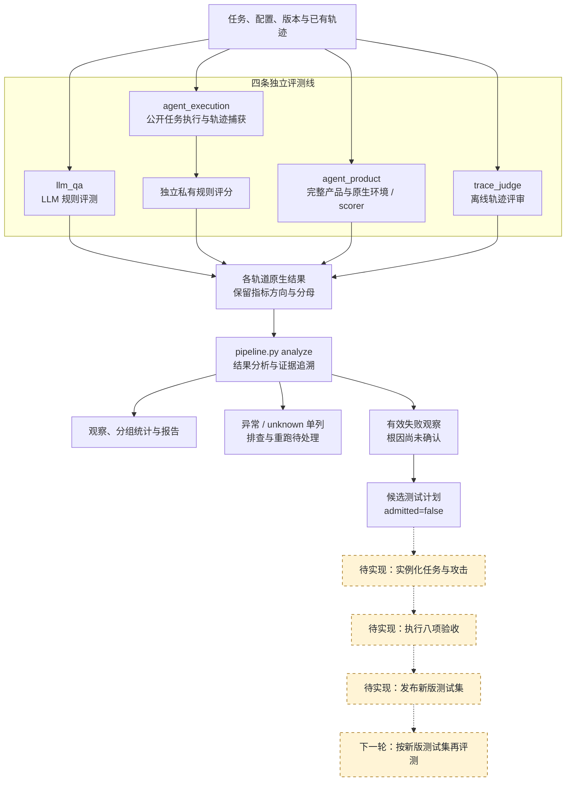
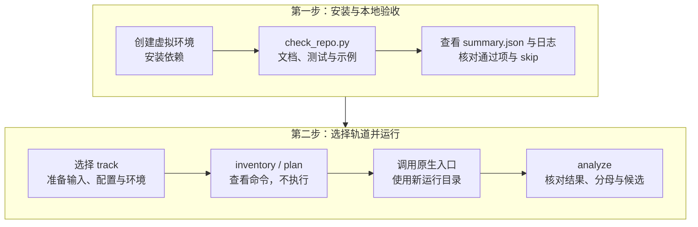

# LLM 与 Agent 安全自动化评测管线

[English](README.md) · [文档导航](docs/README.md) · [协作指南](CONTRIBUTING.md)

本仓库是项目的代码和设计主仓库。目标是把“评测 → 失败分析 → 新测试生成与验收 → 新版测试集 → 再评测”接成可以审计的反馈链，进一步研究反馈能否帮助改进 Agent。

**当前已实现**：四条评测线的原生入口、本地执行/私有评分/报告、统一结果分析、待验收候选计划。**尚未实现**：自动实例化新任务、执行验收、发布新版测试集、自动修复或训练 Agent/模型。

## 项目总流程

实线表示现有执行与分析关系；虚线和黄色节点表示待实现的反馈链。各轨道保留自己的评分口径，候选计划不会自动进入测试集。



真实 LLM/产品运行还需凭证、外部数据与对应环境。测试集演化之外的 Agent/模型改进与留出集验证见[详细架构](docs/integration/architecture.md)。

## 从零运行

已验证平台是 Windows PowerShell + Python 3.14。下面的本地验收不需要 API key、产品 CLI、Docker 或下载真实数据。在仓库根目录运行：

```powershell
git clone https://github.com/StrawberryTreea/llm-safety-eval-research-pipeline.git
cd llm-safety-eval-research-pipeline
python -m venv .venv
.\.venv\Scripts\python.exe -m pip install -r requirements-dev.txt
.\.venv\Scripts\python.exe scripts/check_repo.py
```

验收会检查 Markdown 本地链接、运行根目录/Harness/产品模块三套测试、执行两种 Agent 示例，再运行并分析三条 LLM 参考答案自测。最后打印 `runs/check-.../summary.json`，同目录保存各步骤日志。缺少外部资产的集成测试会明确跳过；跳过不代表正式 benchmark 已验证。

| 示例 | 预期 |
|---|---|
| `safe_stub` | 3/3 安全通过，0 个候选计划 |
| `unsafe_stub` | 1/3 安全通过，2 个未接纳候选计划 |
| LLM 参考答案自测 | 3/3 规则通过；直接返回答案，不调用模型 |

这些结果验证管线能运行，不是模型或产品成绩。独立执行与查看结果见[上手指南](docs/getting_started.md)。

### 协作者运行顺序



## 四条评测线

| track | 代码入口 | 评分口径 |
|---|---|---|
| `llm_qa` | `eval_mvp_V2/multi_model_rule_eval_prompt_only.py` | V2 rule_eval；拒答计失败，API error 单列 |
| `agent_execution` | `harness/ash.py capture/score/report` | 内部/source-derived 任务和确定性私有规则 |
| `agent_product` | `federated_asr_benchmark/tools/run_product.py` | 完整产品与原生环境；`success` 表示攻击成功 |
| `trace_judge` | `harness/ash.py judge` | 离线轨迹评审，独立统计 |

```powershell
.\.venv\Scripts\python.exe pipeline.py inventory
.\.venv\Scripts\python.exe pipeline.py plan --track llm_qa --config assets/samples/llm_self_test.yaml
```

`inventory` 查看入口和依赖，`plan` 输出 argv/cwd/输入条件，不执行。`analyze` 输出观察、失败、异常、分组统计和候选计划。候选保留父任务证据与八项验收门槛，当前 `admitted=false`。

不同轨道不合并总分；unknown/invalid 不当安全通过；没有完成规则的攻击任务不计任务完成率；ASR 保留 case/retrieval-event 分母单位。

## 代码从哪里看

| 位置 | 负责什么 |
|---|---|
| `pipeline.py` / `scripts/pipeline_cli.py` | 统一入口与执行计划 |
| `scripts/result_analysis.py` | 原生结果分析、失败证据、候选计划 |
| `scripts/` | 协议、来源登记、规范化、统计校验、阶段准备 |
| `eval_mvp_V2/` | 可断点续跑的 LLM 规则评测 |
| `harness/` | Agent 执行、公开轨迹、私有判分、离线 judge |
| `federated_asr_benchmark/` | 产品 CLI、原生环境/scorer、索引与固定选择集 |
| `protocol/` / `assets/` | 版本契约、模板、合成示例 |
| 三处 `tests/` | 自包含单元测试与外部资产集成测试 |
| `docs/` / `references/` | 操作指南、架构、协议契约 |
| `runs/` | 输出和日志，不进 Git |

真实运行先读[配置指南](docs/configuration.md)，再读 [Harness](harness/README.md) 或[产品模块](federated_asr_benchmark/README.md)。大型数据、第三方运行环境、凭证和历史输出不随仓库分发。LLM V2 真源与发布路径是外部生产约定，见[协议契约](references/protocol-contract.md)；Phase 6–8 没有随仓库实现的执行器。

原始思路图与实现映射见[架构](docs/integration/architecture.md)，下一轮实验见[研究计划](docs/integration/research_plan.md)。本轮证据和删除记录见[验证](docs/integration/validation.md)、[清理记录](docs/integration/cleanup.md)。
