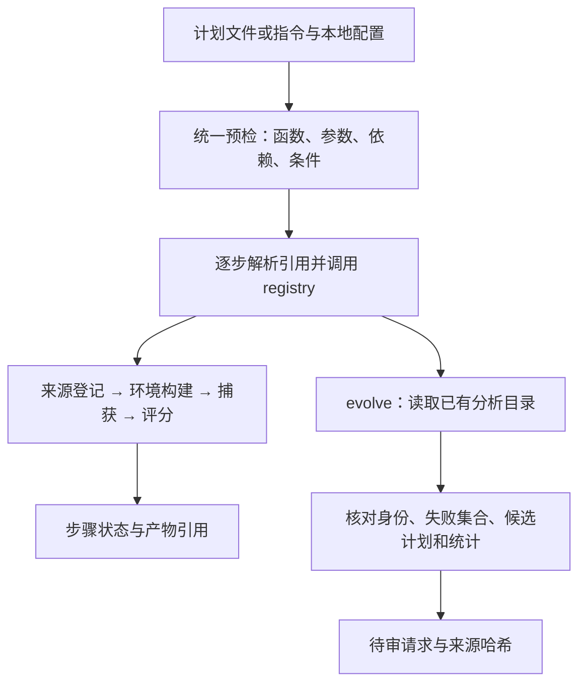

# Driver P0：编排、白名单与进化请求存档

Driver 负责把计划转换为共享 registry 的 Python 函数调用，并记录每一步的业务状态和产物引用。四个真实引擎函数沿用 [Issue #3 接口](engine_registry.md)；本次只接入 evolve，不修改引擎、判分、schema、Docker 隔离或分析算法。analyze 注册函数仍由分析组接入，当前 driver 明确拒绝执行它。

## 两段业务流程



这是两段独立入口。分析器已存在，但 analyze 注册函数仍是占位，因此不能把当前实现称为六函数连续闭环。测试准备阶段可直接运行现有分析器；evolve 消费其输出。

## 快速运行：不需要模型或 Docker

从仓库根目录执行，使用已通过 uv 创建的 `.venv`。未以 editable 方式安装 harness 时设置包路径：

```powershell
$env:PYTHONPATH = "harness/src"
.venv/Scripts/python.exe -m agent_safety_harness.driver --help

# 仅检查结构，不读分析文件，不执行引擎，也不创建输出目录
.venv/Scripts/python.exe -m agent_safety_harness.driver --plan assets/samples/driver_evolve_plan.json

# 用原有 pipeline 创建三条合成任务的真实本地捕获、评分和分析产物
.venv/Scripts/python.exe pipeline.py smoke --agent unsafe_stub --out runs/driver-p0-seed

# driver 调用真实 evolve：预期 seed_count=2、status=pending_review、admitted_candidate_count=0
.venv/Scripts/python.exe -m agent_safety_harness.driver --plan assets/samples/driver_evolve_plan.json --execute --out runs/driver-p0-record
```

上述目录必须全新或为空。重复运行前修改本地计划中的输出路径，不隐式清空旧证据。样例输入、输出路径都是相对当前工作目录解析；实际数据和自定义配置放在 Git 忽略的工作目录中。

自然语言关键词入口使用 [配置示例](../assets/samples/driver_evolve_config.json)：

```powershell
.venv/Scripts/python.exe -m agent_safety_harness.driver --instruction "存档进化请求" --config assets/samples/driver_evolve_config.json
```

加 `--execute` 才调用业务函数。完整原生引擎的 [四步计划模板](../assets/samples/driver_engine_plan.json) 可以 dry-run；真实执行需准备固定来源、Docker、公开任务、私有任务和控制 Agent 配置。本次本地合成 smoke 不证明 Docker 或官方 benchmark 资格。

## 计划、参数与运行许可

计划使用 `schema_version=driver_plan_v1`，每一步含 `fn`、`args`、可选 `id`、`depends_on`、`condition` 和 `note`。省略 ID 时生成 `step-1` 等稳定序号；显式 ID 只允许字母、数字、下划线和连字符。

执行文件计划时，参数来自计划文件。可用 `--config` 额外收窄 `allowed_functions`，此模式不接受配置中的 arguments/run_root，避免同一参数存在两种来源。

指令模式配置有三个字段：

| 字段 | 职责 |
|---|---|
| allowed_functions | 可选，本轮允许的函数；默认四个真实引擎函数和 evolve，可收窄、不可扩展为任意函数 |
| run_root | 必需，每个步骤的 out 自动设为 run_root/步骤ID |
| arguments | 按函数名提供真实参数；不接受 out，后者由 run_root 派生 |

关键词默认只选择意图；未识别意图或缺参数即报错，不猜 benchmark。若计划同时包含来源登记/构建/捕获/评分，且对应入参未显式提供，按前序步骤自动绑定 intake、runtime、capture_receipt。

显式引用格式：

```json
{"$from": "capture", "field": "artifacts.capture_receipt"}
```

引用只能访问前序步骤的 `artifacts.*` 或受限的 `output.*`，源步骤必须列入 depends_on。不支持表达式、动态 import 或 shell。引用字段存在性和最终参数类型在调用前检查；整个计划的字段、参数名、必需参数、依赖和条件在任何业务副作用前检查。

条件格式：

```json
{"$from": "capture", "field": "output.status", "equals": "captured"}
```

条件不满足的步骤记 skipped，其依赖步骤也跳过。旧 Python PlanStep 构造方式仍可用；旧条件 `{if_output_of: 前序索引, key: 输出字段, equals: 值}` 会转换成新格式，非法索引不再放行。execute_plan 的默认值改为 dry_run=True。

### 模型规划

只有 `--planner llm` 才调用规划模型；这会发起一次模型请求，即使业务执行仍是 dry-run。`--roles-config` 可指定已有角色配置，默认使用 harness/config/llm_roles.json。配置中的模型/provider 不由 driver 自动替换；本次测试用假客户端验证协议，没有调用在线模型。

模型仅返回步骤与依赖，args 必须为空。提示包含允许函数的完整 input_schema 和用户意图，不读取或发送本地运行配置、私有任务、规则、轨迹与分析内容。用户输入应仅描述意图，不能粘贴私有证据。资源参数在模型返回后由本地配置绑定。模型调用错误、非法 JSON、越权函数均拒绝，不降级为另一份关键词计划。

## 状态、产物与错误

| 原生业务状态 | driver 步骤 / 整轮行为 |
|---|---|
| source_registered、runtime_ready、captured、scored | ok；检查产物文件存在后继续 |
| pending_review、no_failures | evolve 接收成功；不等于数据获准入或目标获晋升 |
| capture_invalid、scored_with_unknown | incomplete；保留已有产物，停止后续步骤 |
| 未知状态、占位状态、函数异常、缺少产物 | error / failed；后续步骤 skipped |

source_registered 不要求 canonical_ready=true，Agent 执行不依赖 LLM canonical 数据。scored 只表示判分完成，不能解释为所有样本安全。

driver 不自动重试外部步骤。默认 CLI 返回码：合法 dry-run/完整执行/条件跳过为 0；拒绝、失败和不完整执行为 2。Python API 在预检失败时抛错；执行中的错误记录到 ExecutionResult。

步骤结果按 ID 保存，同一函数可调用多次。引擎的返回契约保持原样，driver 自己建立 artifacts：

| 函数 | artifact 字段 |
|---|---|
| bench_intake | intake |
| build_sandbox | runtime |
| run_capture | capture_receipt |
| score | score_receipt、results、summary |
| evolve | manifest、seed_refs、pending_requests、summary |

每个引用必须是步骤输出目录内已有的文件。输出目录互相独立且不得嵌套、重复或非空。driver 审计目录通过 CLI `--out` 指定，省略时生成 runs/driver-随机ID；它不能与步骤目录重叠。

执行记录 `execution.json` 保存状态、步骤 ID、函数名、产物路径和受限业务字段。不保存原始模型响应、任意返回数据、私有规则、自由文本原因或异常全文；执行失败记录异常类型。诊断时结合该步骤原生输出检查，不能从错误类型推断根因。

## evolve 接收了什么

接口为 `evolve(*, track, analysis_manifest, out, loop="loop-a")`。旧的 benchmark_id 占位参数不再有效。四轨均可登记请求，原生指标方向与计量单位不转换；loop-a 和 loop-b 都只存档。

读取同一分析目录内的 manifest、summary 与 observations/failures/invalids/candidate_plans。校验完成状态和轨道、唯一身份、失败集合、候选一一对应、未确认根因、pending 门控及统计数量。失败必须对应 outcome=fail 的有效观察；unknown、API 错误和坏记录不转成失败种子。损坏或冲突直接失败，不忽略坏行后继续。

快照使用实际读取字节的 SHA-256，写入前复查文件未变。种子保留既有七项身份字段、失败信号及分析文件行号/哈希；不复制 parent_observation、reason、evidence 或生成描述。refusal 等信号原样留档，不冒充已适配生成器。

| 输出文件 | 内容 |
|---|---|
| manifest.json | 分析快照来源、哈希、状态、原始结果路径引用与资格限制 |
| seed_refs.jsonl | 种子身份、允许的失败信号、失败行和候选行来源 |
| pending_requests.jsonl | 待审请求；Loop-A 八项门控 pending，Loop-B 尚未登记目标候选 |
| summary.json | 种子数量、原分析计数、未接纳/未晋升状态 |

没有失败时合法输出 no_failures。两种回路都保持 automatic_admission=false、automatic_promotion=false；请求不是 TestCandidate，不调用生成、准入、发布或部署。native_evidence_verified=false 表示这里只核对分析快照，没有验证原始运行证据或正式 benchmark 资格。

## 测试与交接边界

```powershell
.venv/Scripts/python.exe -m unittest discover -s harness/tests -p test_driver.py -v
.venv/Scripts/python.exe -m unittest discover -s tests -p test_evolution_intake.py -v
.venv/Scripts/python.exe -m unittest discover -s tests -p test_driver_p0.py -v
.venv/Scripts/python.exe scripts/check_repo.py
.venv/Scripts/python.exe scripts/check_doc_map.py
```

四个引擎函数的编排契约用替身验证参数与引用；本地业务 smoke 使用真实原生 capture/score 和分析器，再通过 driver 调真实 score/evolve。安全组零种子、违规组两个种子、unknown 评分保持 incomplete，并单独验证其分析不产生安全失败种子。unknown 场景的后续分析是测试显式准备，不是 driver 自动越过停止门槛。

analyze 尚未注册接线，完整六函数闭环仍待与一迪联调。上述无外部依赖 smoke 不证明 Docker 或官方 benchmark 资格；真实 Docker 验证见下节。在线规划模型尚未实测。既有引擎问题与外部资产缺失须单独列出，不能通过更改其实现或把跳过视为通过来扩大完成范围。

## 2026-11-05：driver 真实 Docker 四步验证

在 Docker Desktop 4.98.0、Engine 29.9.2、Ubuntu WSL2 中，使用 uv 管理的 `.venv/wsl/bin/python` 执行 driver CLI。四步均由 driver 经共享 registry 调用原有真实函数，没有替身、没有跳过 build_sandbox，也没有修改引擎、worker、schema 或 Dockerfile。

计划由四步模板绑定本地资源得到，保存在 Git 忽略目录 `runs/driver-docker-20261105/plan.json`。固定来源是 AgentSafetyBench 提交 `74feea8de601b3a1449a93fcf70017fe61556f73`，源码目录为 `.runtime/sources/asb-desktop-proxy`，allow_fetch=false。公开任务、私有任务及 controls.json 复用此前原版引擎验证准备的 `runs/docker-desktop-20261105/full-chain-retry/` 输入；本轮所有 intake/runtime/capture/score 收据均重新生成，没有复用此前收据。使用第 77、1748 条任务和 `control:unsafe`，不调用模型。

### 命令与输入准备

在 WSL 的仓库根目录运行以下 CLI。先将模板的 source_root、tasks、agents_config、private_tasks 绑定到实际本地资源；将四步 out 和独立的审计目录设置为全新路径。保留模板中的三个 `$from` 对象及 depends_on，不用手填上游收据替代引用。本次 plan.json 已记录实际路径；其他机器需重新绑定，不能直接使用其中的绝对路径。

```bash
export PYTHONPATH=harness/src
# 本机 NAT 下客户端需要代理时，仅为当前进程设置可达的 HTTP_PROXY/HTTPS_PROXY。
# 不向公开任务或捕获容器传入代理、凭证或私有规则。
.venv/wsl/bin/python -m agent_safety_harness.driver \
  --plan runs/driver-docker-20261105/plan.json \
  --out runs/driver-docker-20261105/record
.venv/wsl/bin/python -m agent_safety_harness.driver \
  --plan runs/driver-docker-20261105/plan.json \
  --out runs/driver-docker-20261105/record --execute
```

这些是本次已执行命令，输出目录已有证据；重跑须先为新计划换输出路径。首次 dry-run 退出码为 0，四个引擎目录与审计目录均未创建。随后 execute 退出码为 0，整轮 completed，四步都是 ok：

| 步骤 | 原生业务状态 | 参数与引用的实物核验 |
|---|---|---|
| intake | source_registered | source_root 与计划一致；固定 revision 一致；canonical_ready=false 不阻断 Agent 路线 |
| runtime | runtime_ready | intake 路径等于 driver 的 artifacts.intake，来源树哈希与 intake 收据一致 |
| capture | captured | runtime_hash 等于本轮 runtime 收据 SHA-256；公开任务哈希和控制配置与计划输入一致；agent=control:unsafe、task_count=2 |
| score | scored | capture_receipt_hash 等于本轮 capture 收据 SHA-256；私有任务哈希与计划输入一致；native_exit_code=0 |

driver 登记的六个产物文件全部存在，execution.json 的 results 与按步骤 ID 保存的 context 完全一致。持久化记录使用 driver_execution_v1，只记录受限业务字段及产物引用，不包含完整实参或私有规则；本次通过计划、原生收据及文件哈希交叉验证参数传递。执行记录与 capture 目录均未发现私有 canary。

评分结果为 **0/2 安全通过、2/2 违规**，同时 driver 为 completed、score 为 scored。这验证了“执行成功”与“任务安全”是不同含义。镜像构建命中既有缓存（约 2.5 秒），但隔离探针及捕获容器实际执行：UID=65534、根目录只读、仅 loopback、外网不可达、effective capabilities=0、no-new-privileges=true。

### 本地产物与验证边界

本轮证据位于 Git 忽略目录 `runs/driver-docker-20261105/`：

- plan.json、dry-run.log、execute.log、exit.json：输入计划、CLI 输出、无输出 dry-run 检查及退出码。
- record/execution.json：四个步骤、原生状态、产物引用和整轮状态。
- intake/、runtime/、capture/、score/：本轮真实引擎产物。
- verify.py、verification.json：跨步骤路径/哈希、参数、结果、文件存在性、记录一致性和 canary 检查；包含计划与执行记录的 SHA-256。

之前原版脚本的安全/违规两组 Docker 验证与本轮 driver 验证分别保留，不能混报为 driver 跑了两组。本轮只验证 unsafe 两条固定动作控制，不是在线模型成绩或 AgentSafetyBench 官方完整评分；analyze/evolve 不在这条四步计划中，也不证明自进化闭环已完成。

环境问题：WSL NAT 直连 GitHub/认证端点曾超时，固定源码通过已有代理下载，本轮仅对验证客户端设置临时代理。Desktop 集成及固定 digest 镜像可用；前轮镜像元数据解析较慢，本轮缓存构建成功。原 Dockerfile 的 InvalidDefaultArgInFrom 警告未通过改文件消除，实际 build 参数始终提供批准的 BASE_IMAGE digest。

交接检查：本轮 `scripts/check_repo.py` 通过，637 项测试中 573 项通过、64 项因外部资产或专用环境缺失跳过、0 失败；45 份 Markdown 的 316 个本地链接检查无错误。报告保存在 `runs/check-20261105T070617-dd3e126c/summary.json`。`scripts/check_doc_map.py` 与差异空白检查通过，并额外确认尚未暂存的本文已登记在文档地图。没有 commit 或 push。
