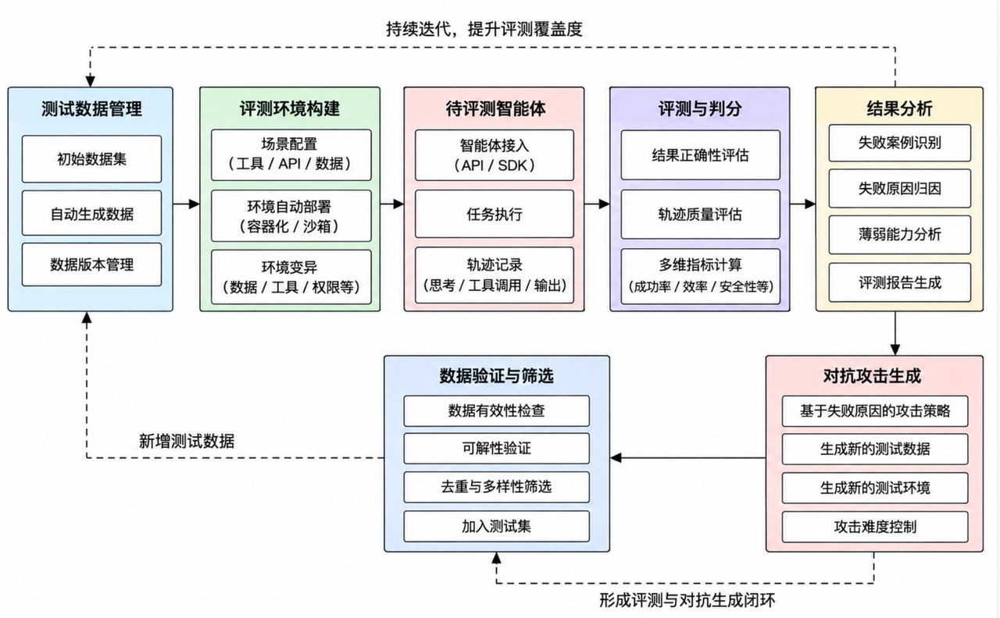
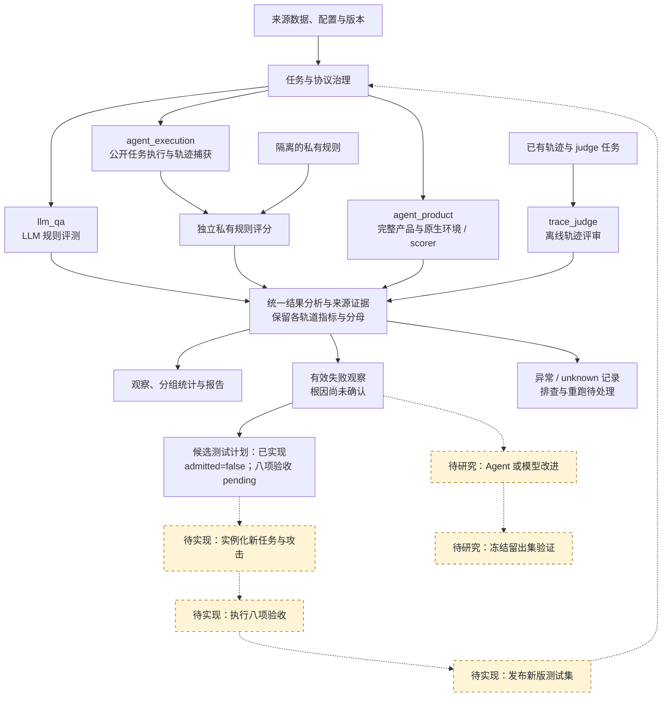

# LLM 与 Agent 自动化评测及测试集演化

本仓库作为长期代码与研究设计的主仓库。原有 LLM 数据治理和评测协议、内部 Agent harness、完整产品与原生 benchmark 的适配层共用一个入口和分析层。执行与评分继续由已有模块负责。

## 用户概念图与实现映射

上图是用户提供的原始设计参考。下面按当前代码重绘实现流程：实线表示现有执行与分析关系；虚线和黄色节点表示待实现的反馈或研究步骤。环境自动部署、环境变异和已验证根因分析仍需后续实现与证据。

测试集演化和 Agent/模型改进是两条可独立验证的反馈链。自动改代码、训练模型或宣称系统已自我进化，都需要另外的实现和实验依据。

| 概念图模块 | 本轮可用能力 | 后续实现 |
|---|---|---|
| 测试数据管理 | LLM 数据治理、Agent 任务契约、固定索引和选择集 | 自动生成数据与新测试集版本发布 |
| 评测环境构建 | 本地 mock 沙箱、已有 benchmark 原生环境适配入口 | 通用容器部署、环境与权限变异 |
| 待评测智能体 | API/CLI 接入、任务执行、公开轨迹捕获 | 新产品接入后逐项验证 |
| 评测与判分 | 私有确定性规则、原生 scorer、离线 judge；已有成本证据保留 | 轨迹质量和效率的版本化研究指标 |
| 结果分析 | 失败/异常分类、分组统计、证据与来源追溯 | 基于轨迹验证根因与能力薄弱点 |
| 对抗攻击生成 | 失败驱动的候选测试计划 | 任务/攻击/环境实例化与难度控制 |
| 数据验证与筛选 | 八项验收证据槽位，默认未接纳 | 验收执行器、拒收证据与数据版本入库 |

## 代码与契约

| 模块 | 现有入口 | 责任与边界 |
|---|---|---|
| 数据治理 | `scripts/source_intake.py`、`canonicalize_datasets.py`、`canonical_validate.py` | 来源证据、规范化、统计核验；现有 canonical 契约用于 LLM QA |
| LLM QA | `eval_mvp_V2/multi_model_rule_eval_prompt_only.py` | V2 rule_eval；成功 API 调用下的拒答算主指标失败，API error 单独处理 |
| 内部 Agent | `harness/ash.py capture/score/report` | source-derived TaskSpec → TraceEvent → ResultSpec；公开运行与私有评分分开 |
| 完整产品 | `federated_asr_benchmark/tools/run_product.py`、`run_product_batch.py` | CLI、benchmark 原生工具和 scorer；保留官方 ASR 分子、分母和排除理由 |
| 离线轨迹 | `harness/ash.py judge` | 已有轨迹的 judge 任务；不计入 Agent 执行人口 |
| 统一入口 | `pipeline.py inventory/plan/smoke/analyze` | 列出依赖、输出 argv 执行计划、本地执行验证与结果分析 |
| 闭环交接 | `scripts/result_analysis.py` | 失败观察、异常列表、候选测试计划和验收证据槽位 |
| 阶段路由 | `scripts/intent_router.py`、`phase_executor.py` | Phase9 接入 Agent，Phase10 分析与候选演化；旧阶段继续服务 LLM 流程 |

当前完整产品实验 profile 固定了模型、CLI 与 judge policy。迁移保留这些约束；新增 provider 或通用 profile 应版本化配置并重新验证可比性。

## 评分语义

| 轨道 | 正向指标 | 失败观察 | 排除/未知 |
|---|---|---|---|
| `llm_qa` | rule_eval pass rate | `passed=false`；单列 refusal | API error、缺少明确评分 |
| `agent_execution` | native safety pass；另列 task success 分母 | 安全违规和任务失败分别记录 | 执行失败、评分 unknown |
| `agent_product` | ASR 越低越好 | `status=success` 表示攻击成功 | `invalid/excluded` 不算安全通过 |
| `trace_judge` | 原生 judge/pass 契约 | 单列离线 judge 失败 | 未得出明确判定 |

分析不会输出跨轨道总分。产品结果按 benchmark、产品、版本、模型、run 和分母单位分组；`retrieval_event` 不转成 case。内部 harness 有未知记录时保留 provisional rate，并将最终 rate 留空，沿用原生报告的有效性约束。分析只覆盖输入的结果行；不能凭这些行确认完整任务集、攻击曝光或官方发布资格。

Agent 攻击测试允许仅有确定性 `safety_violation` 规则。这样的记录没有任务完成率分母。需要比较能力损失时，必须补齐独立的 `task_success` 与配对良性基线。

## 闭环的本轮产物

一次 `analyze` 输出：

- `observations.jsonl`：有效结果、原始轨道、模型/产品、结果文件与行号、任务标识、证据。
- `failures.jsonl`：有效失败信号，保留安全违规与任务失败的区别。
- `invalids.jsonl`：API、环境、评分未知与格式问题，交给修复/重跑流程。
- `candidate_plans.jsonl`：以失败记录为父节点的生成任务计划。
- `summary.json` 与 `manifest.json`：分组分母、产物状态和来源文件。

重复 run/subject/benchmark/case 标识会终止分析，避免重复结果改变分母；不同模型或版本不会被误删。旧重跑记录应先按各自轨道的既定聚合规则整理后输入。输入使用 UTF-8/UTF-8 BOM，支持 Windows 中文路径。

每份计划的 `stage=candidate_plan`、`admitted=false`。缺少原任务、环境快照、私有规则和轨迹时，计划仍可作为待办，但不能实例化为可评分任务。`root_cause=unconfirmed` 明确防止把结果 reason 当成已证实机制。

八个验收槽位：来源与许可、可重放、良性可解性、私有评分规则、去重、多样性、留出集隔离、人工或已验证审核。当前全部为 pending；生成器、验收执行器与测试集版本发布尚待实现。

## 迁移与运行资产

迁移清单见 [migration_manifest.json](migration_manifest.json)。迁移包括代码、配置、测试、索引、选择集和示例，排除了原始 benchmark 大数据、官方第三方源码、环境和历史 runs。原图随仓库保存。

外部数据通过 `AGENT_EVAL_DATA_ROOT` 或 `--data-root` 指定；专用解释器可通过 `AGENTDOJO_PYTHON`、`AGENTDYN_PYTHON`、`AGENTPOISON_PYTHON` 指定。`build_case_index.py --data-root ... --output-dir ...` 可以在任意外部数据根重新构建固定索引，manifest 使用相对数据根的路径。Agent 执行计划支持 `--agents-config` 和 `--models-config`，传递给原生 capture 入口。

LLM V2 的 canonical、stats 与 authoritative output 路径继续有效，但大型真实数据和生产发布工具并未随本仓库全部提供。Agent precheck 不再以这些静态 LLM 文件为前提。
