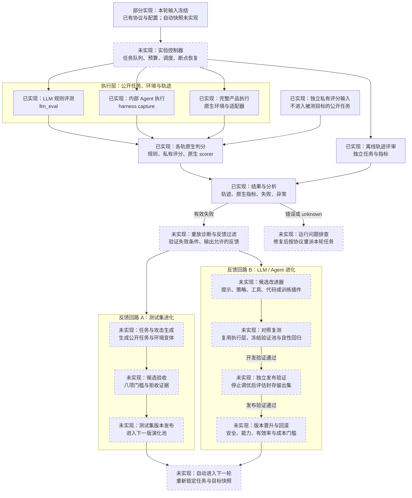

# V1 自动化评测与自进化 Harness：设计草案

状态：设计草案；新增自动控制与进化模块尚未实现。实现状态核对日期：2026-10-13。

## 1. 总体构思

在现有四条评测轨道上增加一个实验控制层：自动安排评测、保存证据、重放诊断、提出候选改进，再用固定的协议验证改进。现有执行器、任务契约和原生 scorer 继续承担实际评测。

整个 Harness 管理两个反馈回路：

1. **测试集进化**：从失败证据提出新任务、攻击和环境变体，通过验收后进入下一版演化池。
2. **目标进化**：从失败证据提出 LLM / Agent 的候选版本，对照复测后晋升通过门槛的候选，保留可回滚的旧版本。

每轮固定 `(任务快照, 目标快照, 环境快照, 协议与评分器, 种子, 预算)`。测试集变化和目标变化分别做对照实验；新增测试用同一目标比较发现能力，候选目标用同一测试集比较改进效果。

这里的 Harness 指平台级实验系统；现有 `harness/` 继续是其中的内部 Agent 执行模块。项目仍是 **V1（1.0.0）**。

## 2. 结构图

节点标明“已实现”“部分实现”或“未实现”；虚线边框表示尚未实现的自动模块。箭头表示目标架构的数据流，自动闭环尚待实现。已实现指当前代码入口与本地链路，真实模型和产品仍需配置数据、目标、环境并验证运行资格。



控制器让两个回路调用同一套评测链。每次调用都生成独立任务清单、运行目录、结果与决策记录；四条轨道分别统计原生指标和分母。版本注册与运行账本覆盖整张图，记录任务、目标、环境、评分器及生成谱系。

图按单轮展开：底部“自动进入下一轮”回到顶部，由控制器重新开始评测。开发验证未通过的目标保留为拒绝记录，允许的失败反馈可继续用于开发阶段优化；运行问题的重派由控制器负责。

发布验证失败时保留上一版目标、拒绝本次晋升；本次封存留出集的逐题结果不进入当前优化回路。

## 3. 复用现有模块的位置

| 架构职责 | 实现状态 | 当前代码 | 下一步需要增加 |
|---|---|---|---|
| 任务与协议治理 | 部分实现 | [source_intake.py](../../scripts/source_intake.py)、[canonicalize_datasets.py](../../scripts/canonicalize_datasets.py)、[protocol](../../protocol) | 任务家族分区、版本注册、演化池与验证池快照 |
| 控制入口 | 部分实现 | [pipeline_cli.py](../../scripts/pipeline_cli.py) | 从 `plan` 的 argv 计划扩展成可恢复的真实任务调度；当前 `plan` 不执行任务 |
| LLM 执行 | 已实现 | [LLM 评测器](../../llm_eval/multi_model_rule_eval_prompt_only.py) | 冻结候选提示/模型配置；新任务类型对应的明确评分协议 |
| 内部 Agent 执行 | 已实现 | [ash.py](../../harness/ash.py)、[TaskSpec / TraceEvent / ResultSpec](../../harness/src/agent_safety_harness/schema.py) | 自动准备公开任务、隔离运行状态、注册候选 Agent 配置 |
| 完整产品执行 | 已实现 | [run_product.py](../../federated_asr_benchmark/tools/run_product.py)、[run_product_batch.py](../../federated_asr_benchmark/tools/run_product_batch.py) | 环境 worker、运行资格与配置版本的统一调度 |
| 评分与离线评审 | 已实现 | `ash.py score/judge`、各产品原生 scorer、LLM 原生规则 | 评分进程与生成进程的读取权限、评分器版本锁定 |
| 结果与反馈起点 | 已实现 | [result_analysis.py](../../scripts/result_analysis.py) | 将现有失败观察与 `candidate_plans.jsonl` 接入重放诊断、反馈过滤与候选生成 |
| 测试验收与发布 | 未实现 | 现有八项 pending 验收槽位 | 实际验收执行器、拒收原因、数据版本 manifest |
| 目标优化与晋升 | 未实现 | 当前尚无自动实现 | 候选构建插件、对照验证、发布门槛与回滚记录 |

当前默认 LLM 输入是三条合成参考题。LLM 轨道的 `rule_eval_failure` 是规则评测失败信号；需要相应安全任务与评分契约才能将其解释为安全问题。内部 Agent、产品和离线 judge 的失败也按各自契约解释。

## 4. 一轮自动闭环如何运行

1. **锁定本轮输入。** 控制器读取实验配置，冻结任务、目标、环境、评分器与预算；生成本轮任务清单。先检查依赖、API/CLI、权限和原生 preflight。
2. **执行与评分。** 按轨道派发任务；Agent / 产品使用独立运行状态，保存公开输入、工具调用、环境变更和资源消耗。评分阶段读取私有规则；离线 judge 有独立任务清单。
3. **核验运行覆盖。** 对照清单检查缺失、重复、排除与 unknown。API/环境故障进入运行问题队列，按预先定义的次数和合并规则重跑，保留所有尝试及成本。
4. **重放与诊断。** 从有效失败中抽取任务、轨迹与环境快照；通过重复执行、良性配对和单条件变换验证失败条件。未确认的根因继续标记 `unconfirmed`。
5. **生成两类候选。** 测试生成器提出新任务；目标改进器提出独立的提示、策略、工具配置、代码补丁或模型候选。生成输入来自允许的反馈视图。
6. **验证测试候选。** 在 staging 中执行八项验收，通过后写入下一版演化池；拒收候选保留理由与谱系。
7. **验证目标候选。** 基线与候选使用相同任务、初始状态、评分器、种子方案和预算，在冻结的开发验证池与良性回归集上比较。旧失败可作回归集；新生成任务可作挑战集，分别报告。
8. **作出版本决策。** 开发阶段满足门槛后停止调优，再运行独立发布验证；通过才晋升。记录基线、候选、证据、阈值与回滚指针。下一轮重新锁定输入。

自动停止条件写入配置：预算或轮数耗尽、连续无有效新发现/可验证改进、有效运行比例低于门槛、环境资格失效。具体阈值在真实小规模实验后锁定。

## 5. 两个回路的具体进化对象

### A. 测试集进化

候选可改变：攻击表达、多轮顺序、工具响应、检索内容、环境初始状态或受控权限条件。每个候选记录父任务、失败证据、变换、生成器、提示版本、种子、环境与评分器。

八项验收沿用当前协议：来源与许可、可重放、良性可解性、私有评分、去重、多样性、留出集隔离、审核。审核可由已经验证的规则自动完成；无法确定的候选保留待审核状态。私有评分规则由受控验收侧建立或验证，保持在独立权限域。

测试回路同时保留覆盖探索配额，采样未充分测试的任务家族、良性任务和跨目标场景。衡量每单位预算发现的独立可重放失败、有效候选率、家族覆盖、重复率及成本。

### B. LLM / Agent 目标进化

| 对象 | 首轮可实现的候选改动 | 验证关注点 |
|---|---|---|
| LLM 的推理配置 | 系统提示、提示模板、模型路由、推理参数 | 当前规则指标、独立安全指标、正常问答能力、拒答与成本 |
| 可修改的 Agent | 规划策略、工具调用规则、权限策略、检索/记忆过滤、沙箱中的代码补丁 | 安全违规、攻击成功、任务完成、工具可用性、正常任务回归 |
| 外部完整产品 | 产品允许配置的模型、策略、工具与运行 profile | 原生 ASR、版本与配置可比性；profile 变化单独记录 |
| 可训练模型权重 | 经授权的 SFT / LoRA 等训练插件产生的 checkpoint | 数据许可与污染检查、固定对照、能力回归、训练和推理成本 |

首个可运行闭环建议选择一个真实 LLM API 目标和一个可修改的内部 Agent，只开放明确的提示/策略/工具配置变换。权重训练通过独立 trainer 插件接入并登记 checkpoint；Harness 负责数据交接、任务调度、评测与版本决策。

目标晋升按轨道设定门槛：安全改善达到预设幅度与可信度，正常任务能力不超过允许退化，运行覆盖和有效率达标，成本与时延在预算内。阈值、重复次数和任务家族统计方法在候选结果出现前固定。没有任务完成 oracle 的攻击任务，仅参与其可定义的安全指标；能力回归另外使用有明确完成规则的良性任务。

## 6. 数据隔离与可比较性

- **演化池 E：** 可提供允许的失败反馈；新验收任务进入它的后续版本。
- **开发验证池 V：** 每次候选比较中冻结；可用于迭代选择，报告其已参与调优的角色。
- **发布留出集 H：** 生成器和改进器不可读任务、轨迹、答案及逐题评分；停止本次调优后按预先定义的方案独立评估。后续若用于调优，则改为回归数据，新的发布结论使用新的独立留出集。
- **家族级隔离：** 任务父子谱系与跨来源近重复分到同一区域，防止一个原任务的变体跨 E/V/H。
- **反馈视图：** 新增过滤层仅提供允许的公开轨迹片段、失败类型、环境条件和证据引用；真实密钥、私有 oracle、隐藏答案和 H 内容不进入生成输入。原始轨迹作为待分析数据处理。
- **评分锁定：** 被测目标和改进器只能改已允许的目标资产；评分器与协议独立管理。评分规则变更会产生新协议，并重新计算可比较的基线。
- **指标账本：** 分别报告 LLM 规则指标、内部 Agent 安全/能力、完整产品原生 ASR、离线 judge 指标；保留 case / retrieval_event 单位及 unknown、排除、覆盖和成本。

## 7. 建议新增的接口与目录

下面是拟新增布局，不是已经可调用的模块。现有三个执行模块保持各自职责。

```text
orchestrator/
  controller.py           一轮状态机、阶段依赖与停止条件
  scheduler.py            并发、预算、超时、断点与重试记录
  workers.py              包装现有原生入口及其专用环境
  registry.py             任务/目标/环境/协议快照与资产引用
  comparison.py           基线-候选配对、覆盖核验与晋升决策
evolution/
  diagnosis.py            重放、配对和失败条件证据
  feedback_view.py        按权限生成允许的反馈视图
  test_generator.py       将 candidate_plan 实例化为任务候选
  admission.py            八项验收与测试集版本 manifest
  target_optimizer.py     候选提示/策略/代码/训练插件接口
  promotion.py            版本晋升、拒绝与回滚指针
configs/loops/
  llm_agent_local.yaml    目标、任务分区、变换空间、预算与门槛
runs/<experiment>/<round>/
  round_manifest.json    本轮冻结输入与阶段状态
  jobs/                  任务清单、每次尝试及原生输出
  diagnosis/             重放证据与允许的反馈
  candidates/            测试候选、目标候选与谱系
  comparison/            配对结果、覆盖、能力和成本
  decisions/             验收、晋升或拒绝记录
```

运行账本先使用 JSON/JSONL manifest 与文件路径引用，方便本地调试和复现；并发规模扩大后可换存储后端。

| 拟新增契约 | 最少记录的内容 |
|---|---|
| `LoopSpec` | 目标、轨道、E/V/H 引用、环境、协议、允许变换、预算、停止与晋升门槛 |
| `EvalJob` | 任务/目标快照、轨道、环境、种子、预算、尝试号、原生命令与输出目录 |
| `EvaluationEnvelope` | 运行/任务标识、轨道、原生结果路径、版本、有效性、指标方向与单位 |
| `FailureEvidence` | 观察引用、重放记录、良性对照、已验证条件、根因确认状态 |
| `TestCandidate` / `TargetCandidate` | 父节点、候选差异、生成来源、允许反馈引用、验证状态 |
| `PromotionDecision` | 基线与候选、冻结评测资产、覆盖、各项门槛、证据、决策和回滚指针 |

这些是控制层契约；LLM canonical schema、内部 Agent TaskSpec 和产品 request/result schema 保留原生结构。

## 8. 实现顺序

1. **自动评测闭环：** 控制器、原生 worker、快照与账本、覆盖核验、有界重跑。以一个真实 LLM 和一个真实 Agent 验证执行到报告。
2. **测试集进化闭环：** 重放诊断、反馈过滤、受控变换生成、八项验收、测试集版本；与静态/随机变体在等预算下比较。
3. **目标改进闭环：** 提示/策略候选、基线-候选复测、正常任务回归、独立发布验证、晋升/回滚。
4. **扩展插件：** 完整产品、多目标迁移、环境变体与可训练模型插件，逐项验证资格与预算。

第一版成功标准：一次真实失败能沿谱系产生可重放的新任务和候选目标；候选目标在固定验证协议下通过安全、能力、有效性与成本门槛；完整过程可从 manifest 复现。mock 与计划输出用于实现自测，真实闭环资格以实际运行证据判断。

当前实现状态见 [V1 架构](architecture.md)，实验比较与统计原则见 [研究计划](research_plan.md)。
